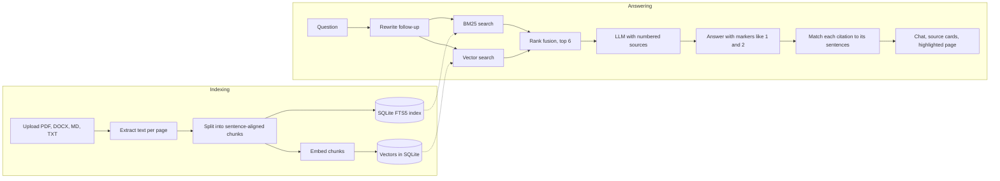

# AI Knowledge Base Chatbot

A chat assistant that answers questions from your own documents. Upload PDFs, Word files, Markdown or text, ask a question in plain language, and get a short answer where every fact has a numbered source. Click a number and the original page opens next to the chat with the exact sentences highlighted.

It is built as a complete, self-hosted RAG (retrieval-augmented generation) application: document parsing, chunking, hybrid search, answer generation with citations, a three-panel web app and an embeddable website widget. It runs with one Docker command and works with OpenAI, a free local model through Ollama, or with no model at all.

**Highlights**

- **Answers with sources.** Every claim carries a citation like `[1]`, and each citation is matched to the sentences that support it, so the viewer highlights those sentences rather than a whole page.
- **Source viewer.** PDFs are shown as real pages with the passage marked on the page. Word, Markdown and text files open in a text view with the same highlighting.
- **Hybrid search.** BM25 keyword search (SQLite FTS5) and semantic vector search run side by side and are merged with reciprocal rank fusion. Keyword search catches exact terms like "SCIM" or "£40", and semantic search catches different wording such as "time off" for "vacation".
- **Follow-up questions.** "And in the second year?" is rewritten into a full question before searching, using the conversation so far.
- **Choose the documents.** Tick which documents to search, like in the left panel of any knowledge base tool.
- **Works without an API key.** Without a language model the assistant answers with the best matching quotes from the documents, still with citations. If the model fails mid-answer, it switches to quotes instead of showing an error.
- **Website widget.** One `<script>` tag adds a chat bubble to any website.
- **Measured.** Unit and API tests, plus a retrieval evaluation (`hit@1`, `hit@3`, MRR) on the sample documents.

## How it works



1. **Parsing.** PDFs are read page by page with pypdf, and running headers and footers that repeat on most pages are removed. Word files are read straight from their XML, keeping headings, bullet lists and tables.
2. **Chunking.** Text is split into sentences, then grouped into chunks of about 900 characters that never cross a page and start fresh at section headings. Each chunk keeps the character offsets of its sentences.
3. **Search.** The question goes to both search methods. Their rankings are merged with reciprocal rank fusion, and the top passages are numbered `[1]` to `[6]`.
4. **Answering.** The model gets the numbered passages and strict instructions: use only these sources, cite every fact, and say so when the answer isn't there. Its reply streams to the browser word by word.
5. **Citation alignment.** When the answer is complete, each `[n]` is matched against the sentences of passage `n`, and the best supporting sentences become the highlight. Numbers that don't exist are dropped.

More detail, including the data model and the streaming protocol, is in [docs/architecture.md](docs/architecture.md).

## Quick start

### With Docker (recommended)

Install [Docker Desktop](https://www.docker.com/products/docker-desktop/), then:

```bash
git clone https://github.com/PallasAthena-prog/ai-knowledge-base-chatbot.git
cd ai-knowledge-base-chatbot
cp .env.example .env        # optional: add LLM_API_KEY for written answers
docker compose up -d --build
```

Open **http://localhost:8000**. The first build takes a few minutes because it downloads the Python packages and a small embedding model. Three demo documents for a made-up company, Northwind Analytics, are loaded on the first start, so you can ask questions right away.

### With Python

Python 3.10 or newer (the Docker image uses 3.12):

```bash
python3 -m venv .venv
source .venv/bin/activate          # Windows: .venv\Scripts\activate
pip install -r requirements.txt
cp .env.example .env
uvicorn app.main:app --reload
```

### Try these questions

- How many vacation days do I get in my first year?
- What should I do if my laptop is stolen?
- Can I work from another country for a few weeks?
- Which tools does Northwind connect to?
- What is the capital of France? (not in the documents, so the assistant says it can't find it)

| Address | What it is |
| --- | --- |
| http://localhost:8000 | The chat app |
| http://localhost:8000/demo | A sample company website with the chat widget |
| http://localhost:8000/docs | Interactive API documentation |

## Choosing a language model

The app talks to any server that offers the OpenAI chat completions API. Set three values in `.env`:

| Provider | `LLM_BASE_URL` | `LLM_MODEL` | `LLM_API_KEY` |
| --- | --- | --- | --- |
| OpenAI | `https://api.openai.com/v1` | `gpt-4.1-mini` | your key |
| Ollama with Docker | `http://host.docker.internal:11434/v1` | `llama3.1` | empty |
| Ollama with Python | `http://localhost:11434/v1` | `llama3.1` | empty |
| Groq, Together, LM Studio, vLLM | their OpenAI-compatible URL | any chat model | if needed |

With no key and the default OpenAI URL, the model is switched off and answers are quotes. Reasoning models that write `<think>` blocks are fine: those blocks are removed before the answer is shown.

After changing `.env`, restart with `docker compose up -d` (or restart `uvicorn`).

## Configuration

All settings are environment variables, usually set in `.env`.

| Variable | Default | Meaning |
| --- | --- | --- |
| `LLM_API_KEY` | empty | API key for the language model |
| `LLM_BASE_URL` | `https://api.openai.com/v1` | OpenAI-compatible endpoint |
| `LLM_MODEL` | `gpt-4.1-mini` | Chat model name |
| `QUERY_REWRITE` | `true` | Rewrite follow-up questions with the model before searching |
| `EMBEDDINGS` | `local` | `local` (fastembed on CPU), `api` (provider's `/embeddings`) or `off` (keyword only) |
| `EMBEDDING_MODEL` | `BAAI/bge-small-en-v1.5` | Embedding model. For `api`, for example `text-embedding-3-small` |
| `TOP_K` | `6` | Passages given to the model per question |
| `CHUNK_SIZE` / `CHUNK_OVERLAP` | `900` / `150` | Chunk length and overlap in characters |
| `SEMANTIC_MIN_SCORE` | `0.25` | Ignore vector matches below this cosine similarity |
| `COMPANY_NAME` / `ASSISTANT_NAME` | Northwind Analytics / Knowledge Base Assistant | Used in the interface and the instructions to the model |
| `ADMIN_TOKEN` | empty | When set, uploading and deleting documents need this token |
| `MAX_UPLOAD_MB` | `25` | Upload size limit per file |
| `LOAD_SAMPLE_DOCS` | `true` | Load the demo documents on the first start |
| `SUGGESTED_QUESTIONS` | four demo questions | Start screen suggestions, separated by `\|` |

Changing the embedding model is safe: on the next start, every chunk is embedded again with the new model.

## Adding the chat to a website

```html
<script src="http://localhost:8000/widget.js" data-title="Ask Northwind" defer></script>
```

Optional attributes: `data-greeting` (the small welcome bubble), `data-color` (a hex colour) and `data-position` (`left` or `right`). The widget opens the chat in a panel, and citations open the source inside it. See it on http://localhost:8000/demo.

For a public website, put the app behind HTTPS and set `ADMIN_TOKEN` so visitors can ask questions but can't change the documents.

## API

| Method | Path | Purpose |
| --- | --- | --- |
| `POST` | `/api/chat` | Ask a question. Streams server-sent events: `status`, `sources`, `delta`, `notice`, `reset`, `final` |
| `GET` | `/api/documents` | List documents |
| `POST` | `/api/documents` | Upload one or more files (`multipart/form-data`, field `files`) |
| `DELETE` | `/api/documents/{id}` | Remove a document and its index entries |
| `GET` | `/api/documents/{id}/file` | The original file |
| `GET` | `/api/documents/{id}/pages/{n}` | Extracted text of one page |
| `POST` | `/api/feedback` | Thumbs up or down on an answer |
| `GET` | `/api/health`, `/api/stats` | Status, model and search mode, usage numbers |

Example:

```bash
curl -N http://localhost:8000/api/chat \
  -H "Content-Type: application/json" \
  -d '{"message": "How long is the free trial?"}'
```

## Tests and evaluation

```bash
pip install -r requirements-dev.txt
pytest
```

The tests cover sentence splitting, chunking, Word parsing, search, citation alignment, the streaming answer flow (with a stand-in model) and the HTTP API.

Retrieval quality is measured on 22 questions about the sample documents:

```bash
python scripts/eval_retrieval.py                 # hybrid search
python scripts/eval_retrieval.py --keyword-only  # BM25 only, for comparison
```

It prints, for each question, the rank of the first passage that contains the expected answer, followed by hit@1, hit@3 and MRR. With Docker, run it as `docker compose exec app python scripts/eval_retrieval.py`.

## Project structure

```
app/
  main.py          HTTP API, streaming, static files
  service.py       Ingestion and the answer pipeline
  parsers.py       PDF, Word, Markdown and text extraction
  textproc.py      Text cleanup, sentence spans, search terms
  chunking.py      Sentence-aligned chunks with offsets
  store.py         SQLite schema, FTS5 index, logs
  search.py        BM25 + vector search and rank fusion
  embeddings.py    Local (fastembed) or API embeddings
  llm.py           OpenAI-compatible chat client with streaming
  answer.py        Prompts, citation alignment, quote answers
  config.py        Settings from the environment
static/            Web app (no build step), source viewer, widget, demo page
samples/           Demo documents for Northwind Analytics
scripts/           Sample generator and retrieval evaluation
eval/              Evaluation questions
tests/             Test suite
```

## Design decisions

- **SQLite for everything.** Documents, page text, the full-text index and the vectors live in one SQLite file. For a knowledge base of up to tens of thousands of passages, a NumPy matrix search takes milliseconds, so a separate vector database would add moving parts without a real gain. The search code is isolated in `search.py` if one is needed later.
- **Sentence-level citations.** Chunks remember where each sentence sits on its page. That is what makes it possible to highlight the supporting sentences on a PDF page, instead of a vague "page 4".
- **Provider-neutral.** The model is reached over the widely supported chat completions API with a plain HTTP client, so switching between a hosted model and a local one is a configuration change.
- **No dead ends.** Without a model, or when the model fails, the user still gets the relevant passages with sources. Without the embedding model, search falls back to keywords.
- **Documents are data, not instructions.** The system prompt tells the model to ignore instructions found inside documents, and every bit of text shown in the browser is escaped.

## Troubleshooting

- **`docker compose up` complains about `env_file`.** The optional `.env` needs Docker Compose 2.24 or newer. Update Docker Desktop, or create the file with `cp .env.example .env`.
- **Answers are quotes instead of written text.** No model is set up, or the model service failed. The sidebar footer shows the current mode, and the notice above the answer says what went wrong (for example a rejected API key).
- **Search says "keyword only".** The embedding model couldn't be loaded. The first local run downloads it, so it needs internet access once. Hover over the status line in the sidebar to see the reason.
- **A PDF has no passages.** It is probably a scanned image without a text layer. Run it through OCR first, then upload it again.
- **Nothing on http://localhost:8000.** Check `docker compose ps` and `docker compose logs app`. The first start can take a minute while the demo documents are indexed.

## Limitations and ideas

- Scanned PDFs need OCR first; they are accepted but show a note that no text was found.
- One shared knowledge base with an optional admin token. Per-user spaces and sign-in would be the next step for a multi-team setup.
- Run a single server process (the default). The in-memory vector cache is per process.
- Ideas: a reranking model after search, OCR with Tesseract, syncing from Google Drive or Notion, and saving conversations.

## License

MIT, see [LICENSE](LICENSE). The sample documents describe a fictional company.
