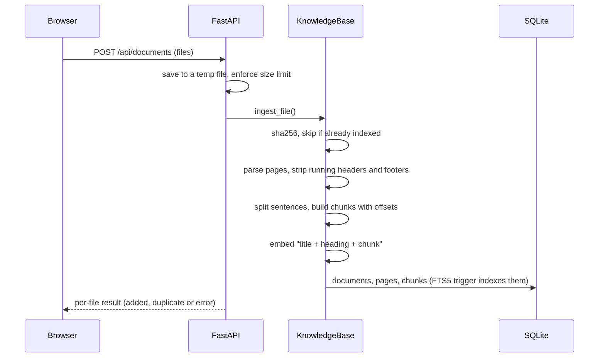
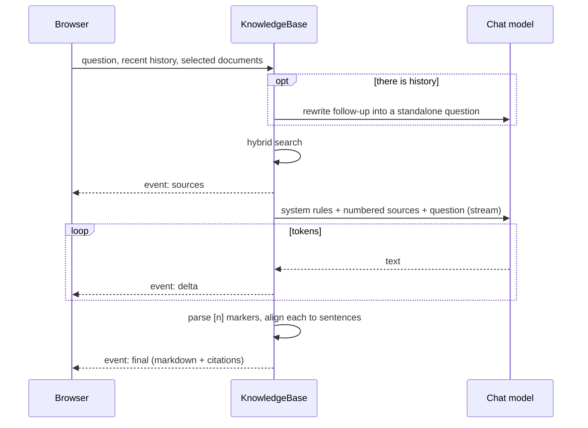
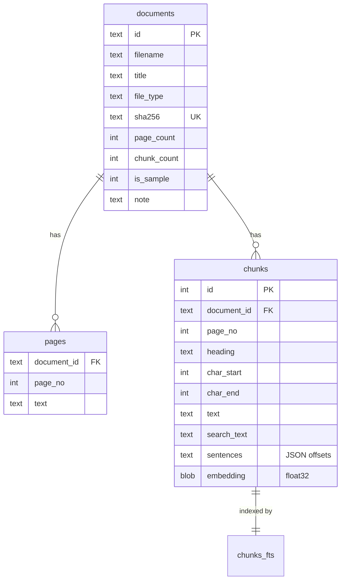

# Architecture

## Components

| Part | Where | Role |
| --- | --- | --- |
| Web app | `static/` | Three panels: documents, chat, source viewer. Plain JavaScript modules, no build step |
| Source viewer | `static/viewer.js` | Draws PDF pages with PDF.js and marks the cited sentences; text view for every file type |
| Widget | `static/widget.js` | Chat bubble for other websites; opens the app in an iframe with `?embed=1` |
| API | `app/main.py` | FastAPI routes, uploads, server-sent events |
| Pipeline | `app/service.py` | Ingestion, query rewriting, retrieval, answering, fallbacks |
| Storage | `app/store.py` | One SQLite file: documents, pages, chunks, FTS5 index, vectors, logs |

## Ingestion



**Sentence spans.** `textproc.split_sentences` returns `(start, end)` offsets into the page text instead of new strings. It groups lines into paragraphs, list items and headings first, then splits paragraphs at sentence ends while skipping abbreviations such as "e.g." and "Dr.". A line counts as a heading when it is short, has no closing punctuation, follows a finished paragraph and isn't continued in lower case on the next line.

**Chunks.** `chunking.chunk_pages` adds sentences to a chunk until the next one would pass `CHUNK_SIZE`. A section heading starts a new chunk once the current one is a third full. The last sentence (or sentences, up to `CHUNK_OVERLAP` characters) is repeated at the start of the next chunk. Chunks never span two pages, so a chunk always has one page number. Each chunk stores `[start, end, is_heading]` for its sentences.

## Retrieval

`search.Retriever.search` runs two searches over the selected documents and merges them:

- **BM25** with SQLite FTS5 (`porter unicode61` tokenizer). The question becomes an `OR` query of its content words. Headings are a separate, lower-weighted column.
- **Vectors.** Chunk embeddings are L2-normalised and kept in one NumPy matrix, which is reloaded when documents change. Cosine similarity is a single matrix product. Results under `SEMANTIC_MIN_SCORE` are ignored, so unrelated questions can come back empty.
- **Reciprocal rank fusion** with k = 60 combines the two ranked lists without having to calibrate their scores against each other. The top `TOP_K` chunks become the numbered sources.

Each source also records its keyword and semantic rank, which the interface shows under "Matched by".

## Answering



**Prompt.** The system prompt asks for answers based only on the sources, a citation after every fact, a plain "couldn't find it" when the sources don't cover the question, and to treat document text as reference material rather than instructions. The previous six chat messages are included, with their citation markers removed.

**Citation alignment** (`answer.finalize_answer`). For every marker such as `[2]` or `[1, 3]`:

1. The claim is the sentence of the answer just before the marker.
2. Each sentence of source 2 is scored by shared content words, with numbers counting double, divided by the square root of the sentence length.
3. Sentences scoring at least 60% of the best one (up to three) become the citation's ranges and quotes. With no overlap at all, the whole chunk is used.
4. The marker is replaced by a placeholder character pair that the browser turns into a clickable number. Unknown numbers are removed.

**Fallbacks.** With no model configured, or when the model fails, `answer.extractive_answer` quotes the best sentences instead. It weights rare words higher, rewards matching word pairs, keeps a list that follows a sentence ending in a colon, and drops sources that score much lower than the best one. If part of a streamed answer was already shown, the browser gets a `reset` event first.

## Streaming protocol

`POST /api/chat` returns `text/event-stream`. Each event is `event: <name>` plus one JSON `data:` line.

| Event | Data | Meaning |
| --- | --- | --- |
| `status` | `{"stage": "searching" \| "writing"}` | Progress for the spinner |
| `sources` | `{"query", "sources": [...]}` | Search query used and the numbered passages |
| `delta` | `{"text"}` | Next piece of the answer, may contain `[n]` markers |
| `notice` | `{"message"}` | Something went wrong with the model; quotes follow |
| `reset` | `{}` | Discard the text streamed so far |
| `final` | `{"markdown", "citations", "mode", "model", "latency_ms"}` | The finished answer. `mode` is `llm`, `quotes` or `none` |
| `error` | `{"message"}` | Unexpected server error |

A citation looks like this:

```json
{
  "id": 1,
  "n": 2,
  "document_id": "4f0c...",
  "title": "Northwind Analytics Employee Handbook",
  "file_type": "pdf",
  "page_no": 3,
  "page_count": 7,
  "heading": "3. Paid time off",
  "label": "Northwind Analytics Employee Handbook, page 3",
  "ranges": [[512, 689]],
  "quotes": ["Your first year: if you join during the year, ..."]
}
```

`ranges` are character offsets into the page text from `GET /api/documents/{id}/pages/{n}`, used by the text view. `quotes` are used to find the passage on the rendered PDF page: the viewer normalises the PDF.js text items and the quotes to letters and digits, finds each quote, and draws boxes over the matching text runs.

## Data model



`queries` logs every question with the search query, mode, number of sources and latency. `feedback` stores thumbs up and down. `meta` remembers which embedding model built the vectors, so a model change triggers re-embedding on the next start.

## Security notes

- Uploaded files are stored under random IDs, never under the uploaded name. Only `.pdf`, `.docx`, `.md`, `.markdown` and `.txt` are accepted, with a size limit and a page limit.
- Word files are parsed with the standard XML parser, and any file with a DTD is refused, which rules out entity expansion attacks.
- `ADMIN_TOKEN` protects uploads and deletion and is compared in constant time. A small middleware checks the token and the declared upload size before the request body is read, so refused uploads never reach the disk.
- Encrypted PDFs that open without a password are supported through pypdf's `crypto` extra; password protected ones are refused with a clear message.
- All document and model text is escaped in the browser. The small Markdown renderer escapes first and only then adds formatting, and it only allows `http` and `https` links.
- The compose file publishes the port on `127.0.0.1` only. Put a reverse proxy with HTTPS in front before exposing it.
